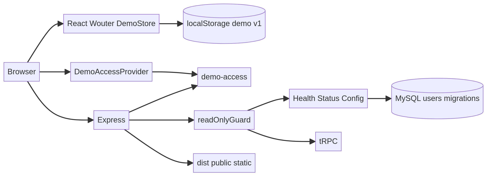
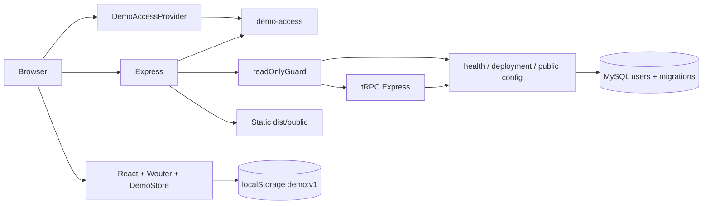

# 02 — Arquitetura

> **CONFIRMADO NO CÓDIGO:** o diagrama e a descrição seguem os mounts de `main.tsx`, `App.tsx`, `server/_core/index.ts`, `readOnlyGuard` e `deployment` citados neste capítulo.
> **A CONFIRMAR:** proxy, TLS, réplicas, storage gerenciado e configuração externa não são dedutíveis do repositório.
> **RECOMENDAÇÃO — não implementado atualmente:** não criar seta de negócio para MySQL nem ativar helpers legados sem contrato e autorização.

## Limite arquitetural

A arquitetura abaixo é a montagem efetiva da base auditada, não o alvo histórico Next/FastAPI/PostgreSQL/MinIO. O alvo histórico permanece documentação de contrato e deve ser revalidado antes de qualquer evolução financeira. No runtime atual não existe seta de domínio financeiro do browser para banco: o estado demo não chama Express, tRPC ou MySQL.

Fonte editável: [`diagramas/arquitetura-real.mmd`](diagramas/arquitetura-real.mmd).

O diagrama é deliberadamente assimétrico: não há ligação `DemoStore → MySQL`, `DemoStore → tRPC`, `DemoStore → Connect`, `DemoStore → Pix` ou `DemoStore → Bank API` no código auditado.

## Frontend

[`main.tsx`](../client/src/main.tsx#L1-L35) cria `QueryClient`, cliente tRPC com `httpBatchLink` para `/api/trpc`, `superjson` e `credentials: "omit"`; monta providers na ordem tRPC → TanStack Query → `DemoAccessProvider` → `App`. [`App.tsx`](../client/src/App.tsx#L26-L61) usa Wouter, lazy/Suspense e `ErrorBoundary`; `ShellRoute` exibe loading, redireciona status não autenticado para `/login` e só monta `DemoProvider` no ramo autenticado.

`AppShell` fornece sidebar desktop e Sheet móvel, breadcrumb, `aria-current`, logout, aviso de dados sintéticos e links para sete módulos e cinco áreas informativas. As oito telas demo são lazy. `DeploymentStatus` é a leitura de servidor ativa de páginas informativas: `GET /api/deployment/status`, sem credencial, sem retry automático e sem cache de negócio.

`DemoStore` contém reducer, seed, ações, validação Zod, persistência em `pmaisfinanceiro:demo:v1`, fallback para seed e sincronização por evento `storage`. `DemoReportsPage` deriva seis vistas, gera Blob/Object URL para CSV e chama `window.print()`; nada é enviado ao servidor.

## Backend/Express e ordem dos middlewares

[`server/_core/index.ts`](../server/_core/index.ts#L14-L57) cria Express, desabilita `x-powered-by`, instala headers/CSP, `no-store` para `/api`, monta acesso demo antes do `readOnlyGuard`, depois parser geral, health/status/config, tRPC, fallback `/api`, guard das páginas demo e Vite/static. A porta é `PORT` ou 3000, o servidor escuta `0.0.0.0`.

O `readOnlyGuard` bloqueia prefixes protegidos e qualquer escrita `/api` com 503. Assim, o login demo não concede passagem às APIs de negócio. `createContext` retorna `req`, `res` e `user:null`; o router contém 14 procedures, mas apenas `deployment.status` pode concluir.

## Banco, storage e cache

O schema Drizzle declara somente `users`; `relations.ts` não tem relações. O estado de negócio demonstrativo fica em `localStorage`; o probe de deployment usa pool mysql2 limitado a 2 conexões, timeout de 4 segundos, `SELECT 1` e cache de 10 segundos. O metadata read-only confirmou as tabelas `users` e `__drizzle_migrations`, sem foreign keys.

Há helpers de presign/S3 e proxy `/manus-storage/*`, mas `registerStorageProxy` não é chamado no entrypoint. O shell tenta um asset gerenciado para a logo e cai no PNG local. Não há upload de comprovante, extrato, PDF ou documento financeiro ativo.

## Autenticação e autorização

A fronteira de sessão é o router `/api/demo-access`: sessão opaca por processo, CSRF vinculado, cookies, rate limit e expiração. É uma barreira de demonstração. Não é JWT de identidade financeira, não é OAuth ativo, não é refresh token e não preenche `ctx.user`.

As páginas são protegidas por `requirePage` para GET/HEAD. A autorização de negócio real não existe porque as operações estão bloqueadas. `publicProcedure`, `protectedProcedure` e `adminProcedure` são conceitos do starter; o `appRouter` atual usa stubs indisponíveis.

## Serviços externos e superfícies legadas

| Superfície | Situação no caminho ativo |
|---|---|
| MySQL/Drizzle | Metadata/schema de `users`; probe `SELECT 1`; sem domínio financeiro. |
| OAuth/SDK/JWT | Helpers presentes, routes não registradas; login OAuth não é ativo. |
| Connect/Pix/Itaú/Bank API | Não identificado no código executável atual. |
| Storage/S3/presign | Helpers presentes; proxy não montado; logo tem fallback local. |
| LLM/notification/image/voice/map/Data API | Helpers/compatibilidade legados ou não alcançados; sem route ativa observada. |
| Open Sans | Referência externa no HTML/CSS; carregamento/licença no ambiente final a confirmar. |

## Filas, jobs e observabilidade

Não há worker, job assíncrono, fila de backend ou scheduler identificado. A única fila é `createAccessQueue`, uma cauda de Promises no cliente para serializar read/login/logout/refresh. O servidor oferece health/status e mensagens de erro; métricas, tracing e alertas não foram identificados. O coletor de debug existe apenas fora de produção e deve ser tratado como risco de desenvolvimento, não como observabilidade de produção.

## Fluxo de dados resumido

1. Browser carrega `index.html`, config pública e bundle.
2. `DemoAccessProvider` consulta sessão; login/logout vão somente para `/api/demo-access` com cookies e CSRF.
3. Após autenticação demo, `App` monta `DemoProvider`; telas leem/escrevem o reducer local.
4. O provider serializa `DemoState` no `localStorage`; outra aba pode reidratar estado validado.
5. `DeploymentStatus` chama status REST; o status pode sondar MySQL, mas só com `SELECT 1`.
6. Requests de escrita de `/api` ou prefixes protegidos param no guard com 503.

## Fontes

[`main.tsx`](../client/src/main.tsx#L12-L34), [`App.tsx`](../client/src/App.tsx#L26-L61), [`DemoStore.tsx`](../client/src/contexts/DemoStore.tsx#L26-L36), [`index.ts`](../server/_core/index.ts#L14-L57), [`readOnlyGuard.ts`](../server/security/readOnlyGuard.ts#L3-L21), [`context.ts`](../server/_core/context.ts#L4-L13), [`routers.ts`](../server/routers.ts#L12-L35), [`deployment.ts`](../server/services/deployment.ts#L18-L68), [`schema.ts`](../drizzle/schema.ts#L1-L28).
