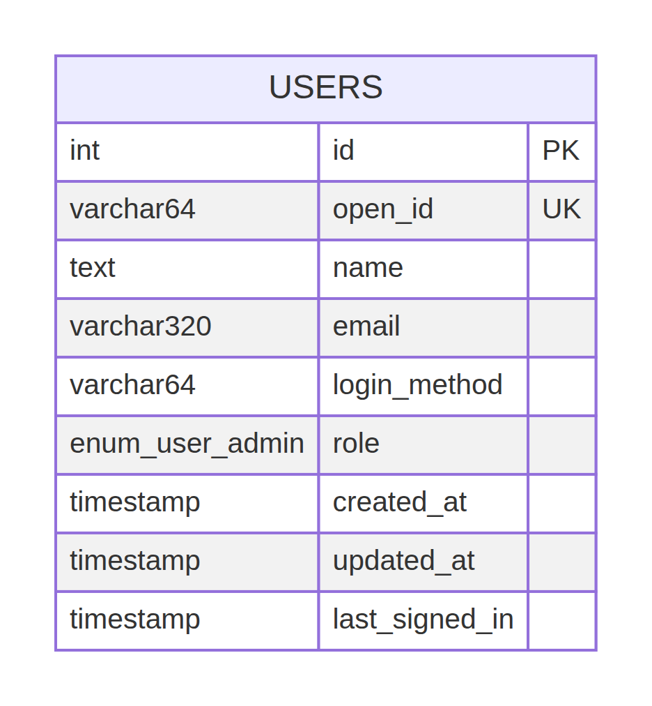
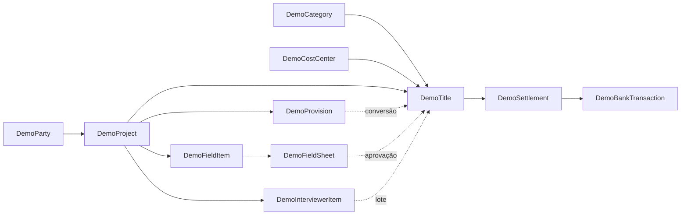

# 04 — Banco de dados


> **CONFIRMADO NO CÓDIGO:** `drizzle/schema.ts`, migration e snapshot declaram somente `users`; o metadata confirma `users` e `__drizzle_migrations` no schema observado.
> **RECOMENDAÇÃO — não implementado atualmente:** não criar schema financeiro por inferência; qualquer evolução deve ter migration, constraints, ownership e controles aprovados.

## Escopo e separação de armazenamento

Há três camadas que não podem ser misturadas:

1. **MySQL/Drizzle:** tabela `users` e tabela técnica `__drizzle_migrations`.
2. **Modelo lógico TypeScript:** entidades `DemoParty`, `DemoTitle`, `DemoBankTransaction` etc.; vivem no estado do browser.
3. **Persistência do demo:** `localStorage` com chave `pmaisfinanceiro:demo:v1`, versão literal `1`, validação Zod e seed sintético.

> **CONFIRMADO NO METADADO:** a inspeção read-only de `information_schema` encontrou exatamente `users` e `__drizzle_migrations`, ambas InnoDB, 12 colunas, quatro índices, quatro constraints e zero foreign keys. Nenhuma linha de usuário ou migration foi lida. Fonte: [`schema-metadata.json`](evidencias/schema-metadata.json#L1-L285).

Não há tabelas financeiras, de títulos, movimentos, projetos, folha, Connect, arquivos ou auditoria no schema rastreado.

O ER SQL isolado é mantido neste diagrama Mermaid e no PNG editável/renderizado; ele descreve somente a tabela `users` e não sugere relações financeiras inexistentes.



Fonte: [`er-users.mmd`](diagramas/er-users.mmd).

```mermaid
erDiagram
    USERS {
        INT id PK
        VARCHAR_64 openId UK
        TEXT name NULL
        VARCHAR_320 email NULL
        VARCHAR_64 loginMethod NULL
        ENUM_user_admin role
        TIMESTAMP createdAt
        TIMESTAMP updatedAt
        TIMESTAMP lastSignedIn
    }
```

## Tabela SQL `users`

### Finalidade

`users` é a única tabela de aplicação declarada no Drizzle. O código e a auditoria a associam a um caminho de identidade/OAuth legado; o entrypoint atual não registra OAuth, `createContext` retorna `user:null` e os routers de auth/admin/finance estão indisponíveis. A tabela não representa usuários financeiros ativos nesta entrega.

| Ordem | Campo | Tipo SQL efetivo | Obrigatório | Default/extra | Chave/índice | Sensibilidade/função |
|---:|---|---|---|---|---|---|
| 1 | `id` | `int` | Não nulo | `auto_increment` | PK efetiva `PRIMARY`; BTREE | Identificador técnico. |
| 2 | `openId` | `varchar(64)` | Não nulo | — | Unique `users_openId_unique`; BTREE | Identificador externo de identidade; sensível como vínculo. |
| 3 | `name` | `text` | Nulo | — | Sem índice | Nome de perfil. |
| 4 | `email` | `varchar(320)` | Nulo | — | Sem índice de e-mail | Dado de contato potencialmente pessoal. |
| 5 | `loginMethod` | `varchar(64)` | Nulo | — | Sem índice | Origem de login potencial. |
| 6 | `role` | `enum('user','admin')` | Não nulo | `user` | Sem índice próprio | Enum exato do banco; não é RBAC financeiro operacional ativo. |
| 7 | `createdAt` | `timestamp` | Não nulo | `CURRENT_TIMESTAMP` | Sem índice | Auditoria técnica de criação. |
| 8 | `updatedAt` | `timestamp` | Não nulo | `CURRENT_TIMESTAMP` | `ON UPDATE CURRENT_TIMESTAMP` | Atualização técnica. |
| 9 | `lastSignedIn` | `timestamp` | Não nulo | `CURRENT_TIMESTAMP` | Sem índice | Último login no modelo legado. |

### Constraints, relações e campos calculados

- PK: `PRIMARY` em `id`, única, BTREE.
- Unique: `users_openId_unique` em `openId`, única, BTREE.
- Foreign keys: nenhuma.
- Referential actions: nenhuma.
- Campos calculados: nenhum declarado; `updatedAt` é atualizado pelo mecanismo SQL, não calculado pela aplicação.
- Índice por email: não identificado no metadata.
- RLS/tenant/ownership: não identificado no código/schema atual.

A migration versionada [`0000_initial_users.sql`](../drizzle/0000_initial_users.sql#L1-L14) e o snapshot [`0000_snapshot.json`](../drizzle/meta/0000_snapshot.json#L1-L110) correspondem estruturalmente ao metadata. Há diferença nominal: SQL/snapshot referem uma PK lógica `users_id`, enquanto MySQL expõe `PRIMARY`; equivalência comportamental confirmada, dependência de nome literal **A CONFIRMAR**.

## Tabela técnica `__drizzle_migrations`

| Campo | Tipo metadata | Obrigatório | Extra/chave | Observação |
|---|---|---|---|---|
| `id` | `bigint unsigned` | Não nulo | `auto_increment`, PK `PRIMARY`, índice único `id` | Identificador técnico. |
| `hash` | `text` | Não nulo | Sem índice adicional | Hash da migration; linhas não foram lidas. |
| `created_at` | `bigint` | Nulo | Sem chave | Timestamp técnico potencial. |

Engine: InnoDB. Esta tabela foi detectada por metadata, mas quantidade, hashes, datas e estado aplicado são **A CONFIRMAR**, pois não houve leitura de linhas.

## Modelo lógico TypeScript fora do SQL

O modelo abaixo é intencionalmente local; não é um ER SQL:



Essas referências, vínculos e derivações são validadas por [`demoValidation.ts`](../client/src/lib/demoValidation.ts#L37-L78) e mutadas por [`DemoStore.tsx`](../client/src/contexts/DemoStore.tsx#L100-L179), não por foreign keys do MySQL.

## Uso efetivo do banco

`server/services/deployment.ts` cria/reutiliza pool mysql2 com `connectionLimit: 2`, timeout de conexão de 4 s, cache de status de 10 s e executa apenas `SELECT 1`. `server/db.ts` possui helper lazy para Drizzle e `upsertUser/getUserByOpenId`, mas a rota OAuth que o usaria não está montada. TLS explícito, least privilege, rede restrita, backup, restore, retenção e RPO/RTO são **A CONFIRMAR**.

## Campos críticos para reconstrução

- SQL: `users.id`, `users.openId`, `users.role`, timestamps e unique de `openId`.
- Demo: `DemoState.version`, IDs DEMO, centavos, datas, `settlements` ↔ `bankTransactions`, `source/sourceId`, `closedPeriods`, referências de projeto/categoria/party.
- Não criar tabelas financeiras por inferência: o repositório não contém contrato relacional executável para elas.

## Fontes

[`schema.ts`](../drizzle/schema.ts#L1-L28), [`relations.ts`](../drizzle/relations.ts#L1), [`0000_initial_users.sql`](../drizzle/0000_initial_users.sql#L1-L14), [`drizzle.config.ts`](../drizzle.config.ts#L1-L15), [`db.ts`](../server/db.ts#L1-L91), [`deployment.ts`](../server/services/deployment.ts#L18-L74), [`DemoStore.tsx`](../client/src/contexts/DemoStore.tsx#L10-L36), [`domínio local`](08-cadastros-e-campos.md).
