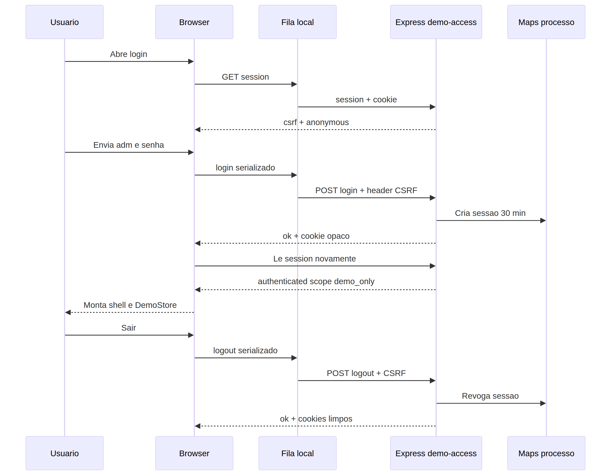
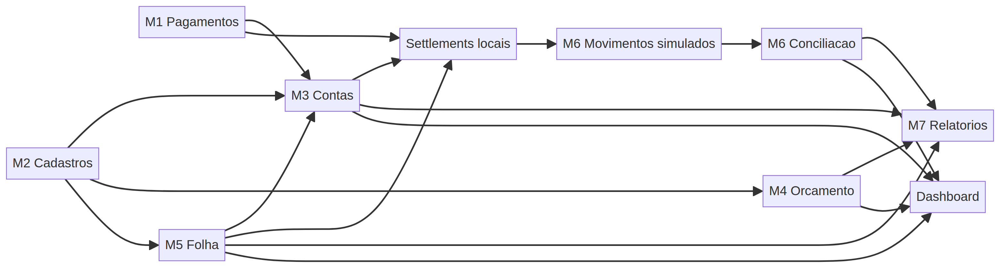
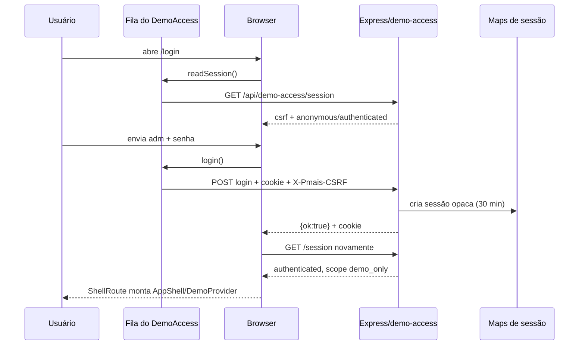

# 10 — Fluxos da aplicação

> **CONFIRMADO NO CÓDIGO:** os fluxos M1–M7 terminam em `DemoStore`/`localStorage`; somente acesso e status atravessam HTTP.
> **A CONFIRMAR:** comportamento de navegador, proxy, cookies, múltiplas abas e instâncias não é certificado pelos diagramas.
> **RECOMENDAÇÃO — não implementado atualmente:** adicionar E2E de browser separado dos testes SSR/fixture antes de declarar aceite operacional.

## Nota de fronteira

Os fluxos M1–M7 abaixo são end-to-end **dentro do browser**. Somente login/logout/status atravessam HTTP. Não há etapa de banco financeiro, Connect, Pix, Itaú, Bank API, upload de extrato ou baixa externa.

Fonte: [`diagramas/acesso-demo.mmd`](diagramas/acesso-demo.mmd).

Fonte: [`diagramas/fluxo-modulos.mmd`](diagramas/fluxo-modulos.mmd).

## 1. Entrada e login demo

A fila serializa `read-before → login → read-after`; falha de `invalid_challenge` permite uma única leitura/repetição, mas erro de rede/senha não é repetido automaticamente. Expiração ou restart retorna ao login. Veja [05](05-autenticacao-autorizacao.md).

## 2. Logout

1. AppShell desabilita botão e chama `logout`.
2. Fila lê sessão e exige CSRF atual.
3. Browser envia `POST /api/demo-access/logout`.
4. Servidor remove sessão/challenge dos Maps e limpa cookies.
5. Provider limpa status/CSRF, lê sessão e ShellRoute volta a `/login`.
6. `pmaisfinanceiro:demo:v1` permanece; logout não é reset de dados.

## 3. Inicialização/reidratação do estado

1. `DemoProvider` é montado somente autenticado.
2. Sem `window`, ou se localStorage estiver ausente/inválido, carrega `createSeedDemoState(todayInSaoPaulo())`.
3. JSON é parseado e passa por `validatedDemoState`; falha descarta snapshot.
4. Cada alteração é serializada na chave exata; erro mantém memória e exibe `persistenceError`.
5. Evento `storage` de outra aba somente aplica valor da chave correta e validado.
6. Dashboard pode pedir confirmação e `resetDemo` para novo seed.

## 4. M2 → M3/M4/M5

1. M2 cria/inativa parties, categorias, centros e projetos.
2. Títulos M3 filtram parties/categorias/centros ativos e projeto opcional.
3. M4 usa projetos/categorias para provisões e orçamento.
4. M5 usa projeto/categoria para itens de campo e folhas.
5. Inativação preserva referências históricas; novos objetos exigem ativos conforme o método.

## 5. M3 título e liquidação

1. Usuário preenche direção, contraparte, categoria, projeto/centro, descrição, datas e valor.
2. `addTitle` valida compatibilidade, datas/períodos, valor e ativos.
3. Título nasce com `settlements=[]`, `source=manual` e documento `nao_aplicavel`.
4. Para pendência `aguardando_demo`, `resolveDemoDocument` troca para `demo_ok` sem receber arquivo.
5. Baixa manual/provisão aceita até saldo; field/interviewer exigem saldo integral.
6. O store cria settlement e movimento bancário sintético; M6/M7 passam a ler o estado atualizado.

## 6. M1 lote de entrevistadores

1. Selecionar projeto, itens pendentes e dueDate.
2. O store exige itens únicos, mesmo projeto, projeto ativo e período aberto.
3. Cria título `pagar`, `source=interviewer`, soma exata, itens `em_lote`.
4. Confirmar “Pagar lote” exige saldo integral e soma exata.
5. Gera settlement/transação local e marca itens `paga_simulada`.

## 7. M4 provisão/orçamento

1. Criar provisão `prevista` para projeto/categoria de despesa ativos.
2. M4 calcula baseline, previsto, comprometido, realizado, saldo e consumo.
3. Converter exige fornecedor ativo e períodos abertos; cria título fonte `provision` e marca provisão `substituida`.
4. Cancelar exige motivo e mantém provisão com `cancelReason`.
5. Nenhum endpoint Connect é chamado; a UI afirma ausência de API real.

## 8. M5 folha de campo

1. Criar itens com quantidade em centésimos e unitário em centavos.
2. Store calcula total por round-half-up inteiro.
3. Criar folha agrega todos os itens pendentes do projeto, cria `aberta`, marca itens `em_lote`.
4. Aprovar cria título `field`, `aprovada_demo`.
5. Pagar exige total exato, gera settlement/transação e marca folha/itens `paga_simulada`.
6. Cancelar só folha aberta remove entidade e devolve itens; sem evento persistente.

## 9. M6 conciliação/fechamento

1. Tela lista transações que nasceram de settlements.
2. Filtra mês/estado; movimento pode ser pendente, conciliado ou exceção.
3. Classificar/conciliação exige mês aberto e classificação não vazia.
4. Exceção exige motivo, marca `reconciled=true` e conserva `exceptionReason`.
5. Fechar exige ausência de pendências; reabrir exige motivo, mas motivo é descartado pelo reducer.
6. Não há importação de extrato real.

## 10. M7 relatório/exportação

1. Selecionar uma das seis vistas e filtros de período/projeto/categoria.
2. `useMemo` deriva linhas do mesmo `DemoState`.
3. Data semântica varia: vencimento, settlement, competência, movimento.
4. CSV é construído no browser com banner DEMO e centavos; Blob/Object URL é revogado.
5. Imprimir chama `window.print`; CSS esconde shell/ações conforme regras de print.
6. Não há upload, endpoint, autorização financeira ou arquivo oficial.

## Fontes

[`App.tsx`](../client/src/App.tsx#L26-L61), [`DemoAccess.tsx`](../client/src/contexts/DemoAccess.tsx#L22-L100), [`accessQueue.ts`](../client/src/lib/accessQueue.ts#L1-L8), [`DemoStore.tsx`](../client/src/contexts/DemoStore.tsx#L26-L36), páginas em [`client/src/pages/demo/`](../client/src/pages/demo/), [`DemoReportsPage.tsx`](../client/src/pages/demo/DemoReportsPage.tsx#L186-L425).
