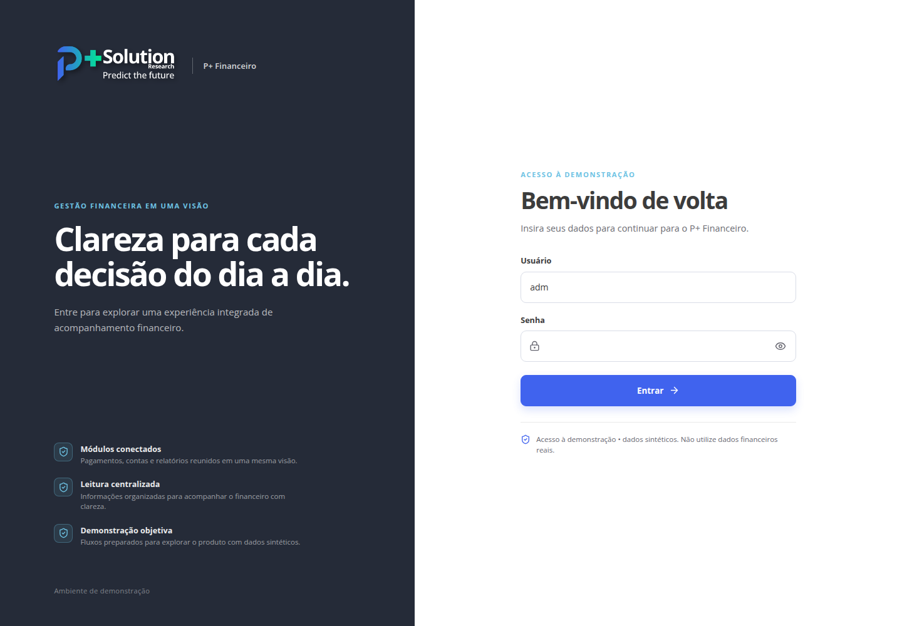

# Anexo — Assets e imagens

Este documento complementa o índice técnico com os arquivos visuais que acompanham a aplicação e esta documentação. Todos os diagramas representam relações encontradas no código/schema; não são telas geradas para sugerir operações inexistentes.

## Identidade visual

- **Logotipo oficial:** [`Logo2025_branco.png`](../client/public/brand/Logo2025_branco.png), asset branco fornecido pelo usuário e preservado byte a byte no projeto. A aplicação usa o asset gerenciado com fallback para essa cópia local. Não existe uma versão colorida confirmada no pacote. Não recolorir ou recriar.
- **Fonte tipográfica:** Open Sans é referenciada pelo frontend; o arquivo da fonte não está versionado. Fonte, origem efetiva em produção e licença são **A CONFIRMAR**.
- **Uso:** a marca branca requer superfície escura. O shell/login existentes já aplicam a identidade institucional; a documentação não cria uma tela que não exista.

## Diagramas determinísticos

Os PNGs são renderizações, por `manus-render-diagram`, das respectivas fontes Mermaid editáveis. Para regenerar, executar `manus-render-diagram <fonte.mmd> <destino.png>` na raiz do repositório.

| Imagem | Fonte | O que representa | Limite |
|---|---|---|---|
| [`arquitetura-real.png`](imagens/arquitetura-real.png) | [`arquitetura-real.mmd`](diagramas/arquitetura-real.mmd) | Módulos React, estado no navegador, gate demo, servidor e probe MySQL efetivamente montados. | Não representa topologia externa, escalabilidade, Connect nem transações financeiras. |
| [`acesso-demo.png`](imagens/acesso-demo.png) | [`acesso-demo.mmd`](diagramas/acesso-demo.mmd) | Leitura de sessão, desafio CSRF, login, logout e bloqueio de API. | O gate não é autenticação de produção, MFA ou RBAC. |
| [`fluxo-modulos.png`](imagens/fluxo-modulos.png) | [`fluxo-modulos.mmd`](diagramas/fluxo-modulos.mmd) | Ligações locais entre cadastros, títulos, orçamento, folha, conciliação e relatórios. | Todos os dados e efeitos são sintéticos e ficam no navegador. |
| [`er-users.png`](imagens/er-users.png) | [`er-users.mmd`](diagramas/er-users.mmd) | Colunas da tabela SQL `users` confirmada, sem relações. | O estado local DEMO não pertence ao ER. `__drizzle_migrations` é uma tabela técnica e não consta do ER de aplicação. |

## Captura da interface

Captura do `/login` executado localmente em 26/10/2026, resolução de 1440 × 1000. O campo de senha está vazio e nenhum login foi realizado. A imagem documenta somente a tela que existe; não representa o conteúdo pós-login nem certifica publicação ou segurança financeira.

Não foram criadas ilustrações de pessoas, comprovantes, telas de integração bancária ou de operações que não existem.

> **A CONFIRMAR:** licença/autorizações de redistribuição do logotipo e brandbook. Esta documentação mantém o asset existente; não concede licença nova nem substitui a autorização do titular.
